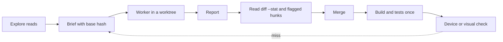

# Orchestration

How this setup splits work between models, and why. The evidence below comes from one person's
projects over about two weeks (roughly 25 logged Sonnet `fixer` runs and about 15 `fixer-opus`
runs, mostly an Android launcher plus a small web app). Treat it as a worked example, not a
benchmark; your stack and briefs will shift the numbers.

## The idea

The main session orchestrates. It plans, writes briefs, reads reports and merges. Everything that
costs a lot of context goes to a worker: reading unfamiliar code goes to a cheap read-only scout,
building goes to a worker in its own git worktree. The goal is the least usage and the smallest
main context that still gets the work right. A worker is worth it when it saves more reading than
its startup costs (about 10k tokens); small edits in files already in context stay in the main
session.

## The loop

1. Explore answers "where is it and what does it do" and returns the conclusion with `path:line`.
2. The brief names the goal, files and anchors, constraints, what is known, verify commands and
   the report format, plus the base commit.
3. The worker checks the base, builds, verifies, commits and reports.
4. The main session reads the report and `git diff --stat`, then full hunks only where the report
   flags something or the work is geometry or layout.
5. After the merge, the project's build and tests run once into a log; Explore reports only the
   failures.
6. Anything visual is looked at by the main session, or by a checker on a device.

## The agents

| Agent | Model | Effort | Does |
|---|---|---|---|
| main session | Fable or Opus (the user's choice) | default | Plans, briefs, reviews, merges. |
| Explore | Haiku | medium | Read-only search; returns conclusions, spawns nothing. |
| `fixer` | Sonnet | medium | Default builder in its own worktree. |
| `fixer-opus` | Opus | medium | The same worker for the named cases below. |
| `lead` | Opus | medium | Runs one wave: decides, briefs fixers one at a time, checks them, reports once with raw evidence. Most useful under a Fable main session; an Opus main session can lead a wave itself. |

Effort stays at each agent's default. For one hard task the main session passes `effort: high` on
the Agent call; text inside a brief does not change effort.

## Routing

`fixer` is the default for any specified change, at any size. `fixer-opus` is reserved for four
named cases. Investigation with an unknown cause is neither: it goes to Explore or to a
reproduction first, and the builder gets the cause in its brief.

| Task | Goes to | Evidence (anonymised) |
|---|---|---|
| Specified feature, any size: policy class plus wiring, several files, settings rows, docs | `fixer` | Dozens of runs in an Android launcher and a web app; nearly all passed, typically 20-70 tool calls and 60-130k tokens. A hand-over feature across a page, a policy and a server API merged unchanged. |
| Geometry or layout with a checkable spec (numbers, a wireframe, a parity test) | `fixer` | A status-bar row seam, a stacked editor with drag, a mockup-matched settings screen: passed, some with review fixes. A cursor glow shader with a JVM-checkable spec passed in 16 calls and was pixel-verified. |
| Graphics and latency work from traces | `fixer` | Five briefs (telemetry, an overlay experiment, a trace root-cause, a hint experiment, a shader prototype): five passes. It missed a whole-window repaint cost the brief did not name. |
| Bug with unknown cause | Explore or a reproduction, then `fixer` | Given an unknown cause, Sonnet diagnosed four of four in one round and refused to guess on a fifth, shipping a tagged log commit that settled it. |
| Specified change that needs review | `fixer`, then read the hunks | Misses were one level deeper than the brief: a cached rebuild skipped on the same card, a debug stack-frame index that assumed desktop frames, a SIGTERM that a process ignores. Fixed by the caller in about ten lines each. |
| Premise may be wrong | `fixer-opus` | Opus refused three wrong premises in a row on a rendering bug and proved a fourth from the evidence. Sonnet also found a false premise in the cheaper comparison, so use Opus when it is likely, not merely possible. |
| A fixer round already missed once | `fixer-opus` | A second attempt at the same task should change something: the model, or the brief with the miss named. (A design rule from the ledger's pattern, not a measured comparison.) |
| Replacing a renderer or pipeline | `fixer-opus` | A live blur renderer passed with review: the new effect's radius mapped to a different sigma than the old one (1.4x blurrier), found on the first screenshot. |
| Spec to be challenged | `fixer-opus` | It stopped at three contradictions in a layout spec and named them before building; on another run it found a flaw in the spec's fallback rule. |

Roughly: Sonnet passed or passed with review on almost every logged task, including the ones that
would previously have gone to Opus. The Opus runs were justified mostly by what they refused to
build, not by raw capability. One side-by-side on an investigation found no quality gap (Opus had a
longer write-up for 152k tokens against 131k).

## What the ledger taught about briefs

- Name the "all edits" scope explicitly. A worker told to "add" a lift stopped at the one function
  the code made look safe; the second round needed one paragraph.
- Spec errors are the caller's. A band specified in the wrong colour domain passed unit tests and
  looked wrong on the device. For render pipelines, require an assertion in the composited domain.
- "No allocation on per-frame paths" belongs in any brief where a helper returns arrays.
- When replacing a renderer, say "match the existing visual's numbers, not just its parameters".
- For code that runs in a sandbox, tell the worker to check each framework call against the
  sandbox's allowlist; two calls behaved differently there and only a live run showed it.
- Give the proportion of a glyph or layout in numbers; a picture alone produced half-height cards.
- Reproduced log lines in the brief made an arithmetic bug checkable in one round.
- A worker that checks your premise against the evidence is doing its job. Do not re-brief it with
  a new guess; give it a reproduction.
- A tool-call cap is worth stating: one run went to 69 calls on a six-file sandboxed change and
  still needed two review fixes.

## The model gate

`hooks/model-gate.py` is a PreToolUse hook on `Agent` and `Workflow`:

- The main session may spawn any model except Fable. Fable is chosen by the user for the main
  session; a subagent, workflow agent or fork must not silently inherit it.
- A subagent may spawn only Explore, on Haiku, with no model override. Workers do not fan out;
  the main session decides what happens next.
- The one exception is `lead`: it may also spawn `fixer` and `device-checker`, with no model
  override, and never another `lead` or `fixer-opus`. The hook tells a lead by the `agent_type`
  field of its input. The chain main, lead, fixer, Explore is three deep, which is why the
  installer sets `CLAUDE_CODE_MAX_SUBAGENT_SPAWN_DEPTH=3`.
- A Workflow is denied when a model is set to Fable in its script or input. From a session on
  Fable (or one whose model the gate cannot read) it is also denied unless every `agent(` call
  in the script names a model, because an agent with no model runs on the session's model.
- The gate fails closed: an error inside it denies the call, and the hook entry carries
  `onFailure: block` so a crash or a timeout blocks too.

The point is cost and predictability: nested agents multiply usage invisibly, and the main
session is the only place where the routing decision has the full picture.
`hooks/test_model_gate.sh` holds the cases.

## Worktree pitfalls

- With the default base, a worker's worktree can be cut from origin rather than the session's
  local HEAD, so it starts behind. Every brief names the expected base hash. The worker runs
  `git merge-base --is-ancestor <hash> HEAD` and stops if it fails, or fast-forwards with
  `git merge --ff-only <hash>` when the brief allows that. When it matters, create the worktree
  yourself at the base and spawn the worker without isolation, told to work in that path.
- The session's cwd can silently reset to the main checkout after a background command. Use
  `git -C <path>` in background chains and never switch branches in a shared checkout.
- A worker that stops with no commits loses its worktree. Continue it with a fresh spawn, not a
  message, or it will edit the main session's tree.
- One worker per seam: one file, one view hierarchy, one hook. Parallel workers only on disjoint
  modules.

## Keeping the ledger

Log every worker outcome in a private file: `$CLAUDE_LEDGER` if set, else
`~/.claude/model-performance.md`. One line each: date, agent, effort, task kind, pass / pass with
review / fail, what it missed, tokens and calls. Keep it outside the repo. Routing rules in
`CLAUDE.md` should change when the ledger changes, for example when Sonnet fails a kind of task
the table says it handles, or passes one that the table reserves for Opus.
